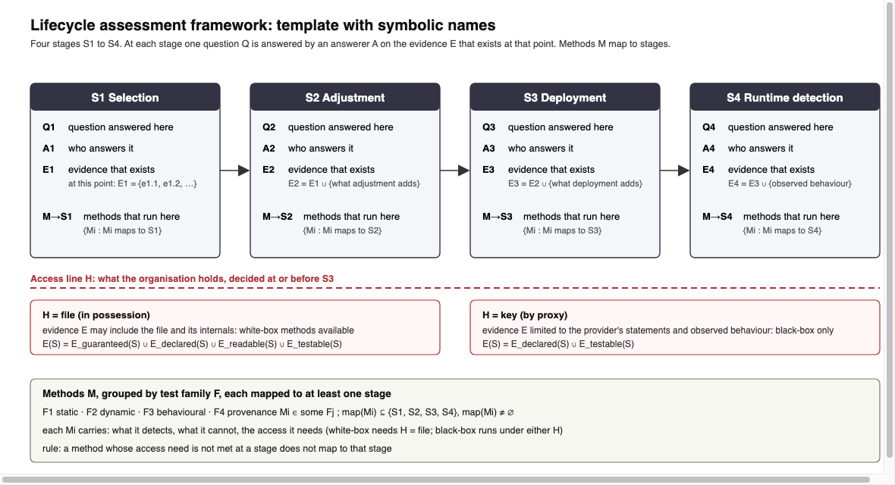

# SCRUM-284 working file: lifecycle stage tables

Status 8 October 2026: selection drafted, pending the user's review; adjustment, deployment and runtime
detection to follow in the same shape. Vocabulary is the glossary's (SCRUM-281): lifecycle stage, test
family, acceptance criterion, gap, in possession, by proxy, attestable and testable properties. Within
attestable, evidence is marked guaranteed (the platform enforces or verifies it), declared (the publisher
states it) or readable (read from the file); testable evidence is measured. No sources yet; sources are
added when the subsection is drafted.

## Notation

Every symbol in the figure and the tables is defined here before it is used. Terms in the right-hand column are the glossary's (SCRUM-281).

| Symbol | Reads as | Definition |
|---|---|---|
| S1, S2, S3, S4 | stage | The four lifecycle stages in order: S1 selection, S2 adjustment, S3 deployment, S4 runtime detection. Each is a point at which a question about the model is answered |
| Q, Qn.k | question | A question answered at stage Sn; k numbers the questions of that stage (Q1.1 is the first question of selection) |
| en.k a, b, c | evidence item | One item of evidence for question Qn.k, lettered within the question; each item carries exactly one kind, guaranteed, declared, readable or testable, and the kind alone decides who answers it, where it exists and which family establishes it (the rule table) |
| A | answerer | Who answers the question: the platform, the publisher, the provider, or the organisation that selects, adjusts, deploys or runs the model |
| E, En | evidence | What exists at stage Sn that can answer a question. Evidence accumulates: En includes everything in En-1 plus what the stage adds, written En = En-1 ∪ {additions} |
| guaranteed, declared, readable | attestable evidence | The glossary's attestable properties, split by who vouches for them: guaranteed, the platform enforces or verifies it; declared, the publisher or provider states it and nothing verifies it; readable, read from the file itself |
| testable | testable evidence | The glossary's testable properties: a property no metadata reveals, established only by running the model; split into outputs, measured black-box, and internals, measured white-box |
| H | access line | What the organisation holds, decided once, at or before S3, and in force for every stage after: H = file, in possession; H = key, by proxy |
| E(S) under H | evidence available | In possession: guaranteed, declared, readable and testable evidence can all exist. By proxy: only declared and testable, because there is no file and the platform's guarantees do not travel with the key |
| M, Mi | method | One assessment method; i numbers the methods once the later chapters name them |
| F1, F2, F3, F4 | test family | The glossary's four test families: F1 static, F2 dynamic, F3 behavioural, F4 provenance. Every method belongs to one family and carries what it detects, what it cannot, and the access it needs, black-box or white-box |
| map(Mi) | mapping | The set of stages a method runs at. It is never empty, which is the item's acceptance criterion, and it excludes any stage where the method's access need is not met: a white-box method does not map to a stage under H = key |
| M→Sn | methods at a stage | The methods whose mapping includes Sn |
| ∪, ∈, ⊆, ∅ | set signs | Union, member of, subset of, empty set |

## Figure: the framework

Template with the symbols above; the stage boxes are filled from the stage tables below once each is agreed, and the figure then carries question numbers in place of symbols.

## The rule: the evidence kind decides the rest

Every evidence item has one kind. The kind fixes who answers it, whether it exists under each access state, and which test family establishes it. The stage tables keep the Jira's three columns, question, who answers, evidence, and add in possession, by proxy and test family; the four columns after the evidence are read off this table, letter by letter, and never filled by hand.

| Evidence kind | Who answers | Exists in possession | Exists by proxy | Test family that establishes it |
|---|---|---|---|---|
| guaranteed | the platform, which enforces or verifies it | yes | no: the platform's guarantee does not travel with the key | provenance |
| declared | the publisher; by proxy, the provider | yes, as a statement | yes, as a statement | none: nothing verifies it, so it is recorded as an assessment gap |
| readable | the organisation, from the file | yes | no: there is no file | static |
| testable, outputs | the organisation, by running or calling the model | yes | yes, black-box | behavioural |
| testable, internals | the organisation, by running the file | yes | no: white-box needs the file | dynamic |

Two consequences for every stage. By proxy, the organisation can establish only declared statements and black-box behaviour; the static and dynamic families drop out, and every question that rested on guaranteed or readable items passes to the provider. A declared item is a gap at every stage and under both access states, so the gaps of the framework are exactly the declared items.

## S1 Selection

The stage asks seven questions. Each evidence item carries its kind; the four columns after it apply the rule above to the letters and nothing else.

| # | Question | Evidence items, with kind | Who answers | In possession | By proxy | Test family |
|---|---|---|---|---|---|---|
| Q1.1 | Where does the model live and who published it? | a. guaranteed: publisher account, upload date, file hashes b. declared: parent model, training data, organisation behind the account | a: platform b: publisher; by proxy, provider | a, b | b | a: provenance b: none, gap |
| Q1.2 | Is the file what the page says it is? | a. guaranteed: the file received is the file published, hash or signature matches the page b. readable: format, whole model or adapter, precision, configuration agree with the page c. declared: the derivation and training claims of Q1.1 b, which the file cannot confirm | a: platform b: organisation c: publisher; by proxy, provider | a, b, c | c | a: provenance b: static c: none, gap |
| Q1.3 | Can loading it harm us? | a. readable: artefact format, pickle or not b. guaranteed: the platform's malware and pickle scan results c. readable: the organisation's own scan of the file | a, c: organisation b: platform | a, b, c | none; the question passes to the provider | a, c: static b: provenance |
| Q1.4 | May we use it? | a. declared: licence and usage terms b. guaranteed: gating, where the platform enforces it | a: publisher; by proxy, provider b: platform | a, b | a | a: none, gap b: provenance |
| Q1.5 | Which row and column of the segmentation is it, and so which threats apply? | a. readable: column (format), precision, completeness b. declared: row (what it produces), modality qualifier | a: organisation b: publisher; by proxy, provider | a, b | b | a: static b: none, gap |
| Q1.6 | Does it behave as described, and is the safeguard present? | a. testable, outputs: measured behaviour on the organisation's inputs b. testable, internals: checks on the file while it runs | a, b: organisation | a, b | a | a: behavioural b: dynamic |
| Q1.7 | File or key? | none: the decision that closes the stage, taken on Q1.1 to Q1.6; it sets the access state for S2 to S4 | organisation | decision | decision | none |

Reading the stage off the rule. In possession, every item exists and all four families run at selection. By proxy, only the declared items and Q1.6 a exist: Q1.3 has nothing left for the organisation, Q1.2 keeps only the provider's word, and the behavioural family is the only one that still measures anything. The gaps of selection are the four declared items, Q1.1 b, Q1.2 c, Q1.4 a and Q1.5 b, under both access states. Q1.6 recurs after adjustment (S2) and as drift at runtime (S4); Q1.2 and Q1.3 recur at deployment (S3) with the provider as answerer when the state is by proxy.

## S2 Adjustment

To do.

## S3 Deployment

To do.

## S4 Runtime detection

To do.
