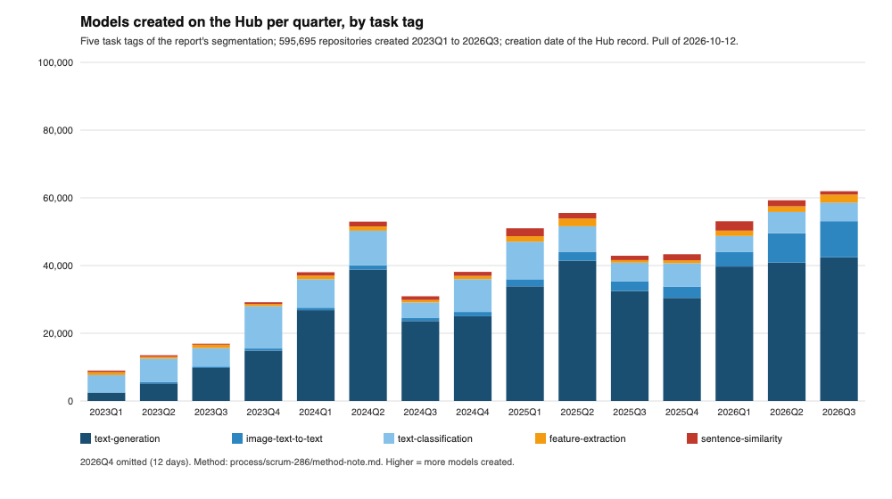
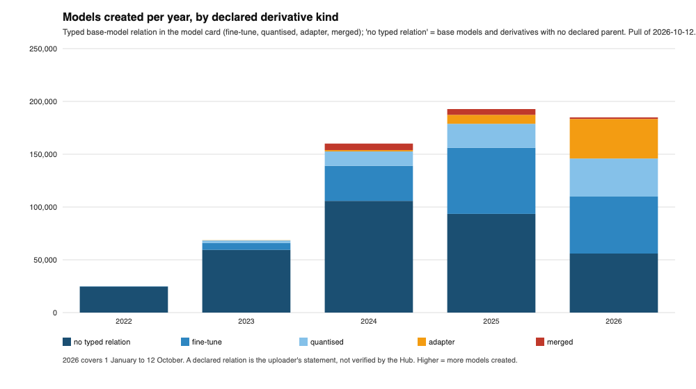
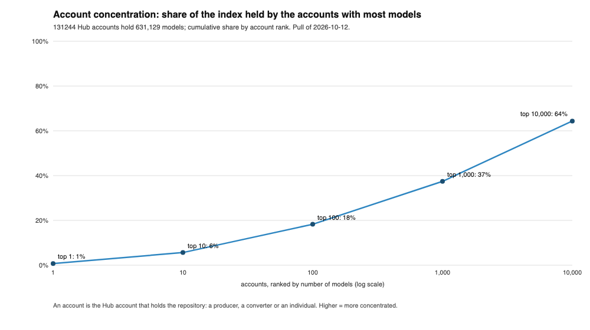
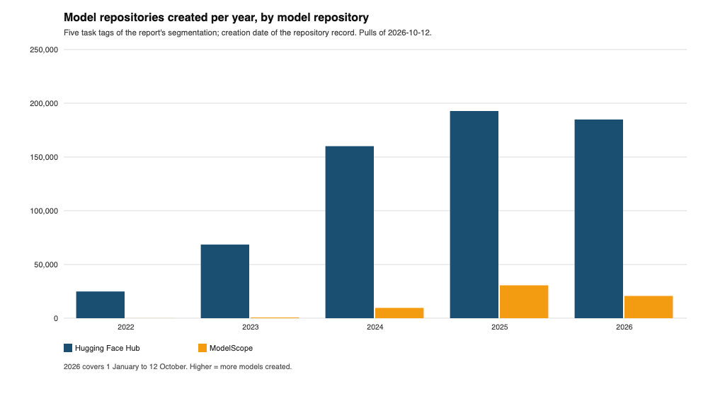
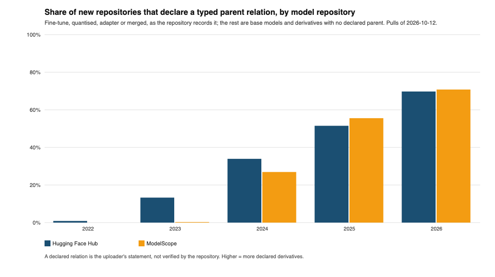
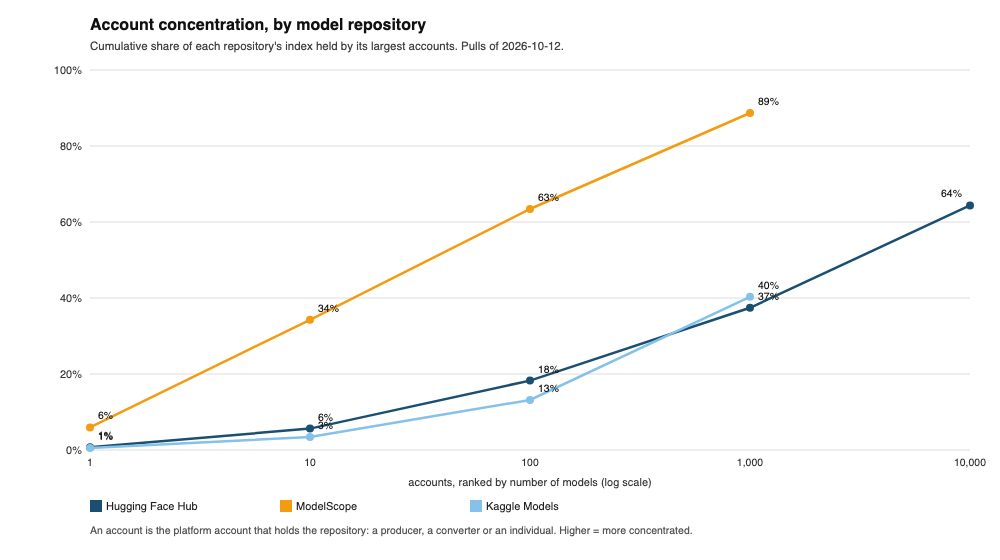

# SCRUM-286: the ecosystem in numbers

Version 1, 12 October 2026. Data cut-off 12 October 2026 (the index pull described in `method-note.md`). Not yet reviewed by Lior (engineering plausibility) or Dan (security implications).

Sections 1, 1a, 2 and 3 are the drafted subsections for the skeleton's 3.3, 3.4 and 3.5; 1a belongs to 3.3 and 3.4 at assembly. Section 4 is what the blocked items take from here. Section 5 is the source log; platform-prefixed citations (HF-, TX-) resolve to the SCRUM-280 log. The ecosystem counted here is the platform set of the landscape item: the model repositories (Hugging Face Hub, ModelScope, Kaggle Models), the package registry and local-inference channel (Ollama), and the redistributors, cloud model gardens, packaged inference microservices and hosted inference providers, which expose no per-model index and enter with their catalogue sizes. The task relies on all of them, each with what it exposes; where a platform lacks a field the table says so. Publication counts and the provenance fields come from the repositories, with the Hub and ModelScope as the two series; use-weighted findings come from Hub downloads, the one channel with per-model counts; the registry and the redistributors are named with their catalogue sizes as the channels through which the repositories' models reach use. Sections 1 and 2 carry the Hub's series, 631,129 models across the five task tags of the report's segmentation, as the primary index; section 1a puts ModelScope beside it on the same method and Kaggle Models where it has the field, so that each finding reads as a property of the ecosystem or of one repository. Every count can be re-run with the method and cut-off date stated; figures and tables are numbered locally and renumbered at assembly. Findings in sections 1 and 2 are measured data and carry the established label; section 3 carries the forecast label throughout and is kept apart.

## 1. Release trends and ecosystem growth

The Hugging Face Hub, the main model repository, held 631,129 model repositories under the five task tags on the cut-off date, two thirds of them under text generation [EC-01]. Creation of new repositories has grown every year since 2022 and has not slowed: the first nine and a half months of 2026 already match the whole of 2025 (Table 1). The year-on-year numbers are the creation dates of the repositories on the repository platform, not release dates; a model first released elsewhere is counted when it reaches the platform.

**Table 1. Model repositories created per year, by task tag** (index pull of 12 October 2026; method in `method-note.md`)

| Year | text-generation | image-text-to-text | text-classification | feature-extraction | sentence-similarity | All five |
|---|---|---|---|---|---|---|
| 2022 | 8,791 | 229 | 12,526 | 2,240 | 1,095 | 24,881 |
| 2023 | 32,211 | 1,578 | 29,991 | 3,162 | 1,631 | 68,573 |
| 2024 | 114,278 | 4,206 | 32,807 | 4,126 | 4,645 | 160,062 |
| 2025 | 138,205 | 10,922 | 31,029 | 5,553 | 7,061 | 192,770 |
| 2026 (to 12 Oct) | 129,400 | 25,208 | 17,799 | 6,456 | 5,980 | 184,843 |

**Figure 1. Models created per quarter, by task tag** (same pull; 2026Q4 omitted, twelve days)

Three things in the quarterly series matter for assessment. Text generation is the volume: about 40,000 new repositories a quarter through 2026. Image-and-text input, the modality qualifier of the segmentation, is the growth: 2,840 in the third quarter of 2025, 10,695 in the third quarter of 2026, nearly fourfold in a year, and already a quarter of the text-generation rate. Classification and embedding models are flat to falling in count while remaining the bulk of what is deployed by download, which is where the widely used sample of section 2 looks.

### 1.1 Derivative and quantised variants

A model card may declare the model's base model, and the platform types the relation as fine-tune, adapter, quantised or merged, inferring it or taking the uploader's explicit setting [EC-02]. Read across creation years, the share of new repositories that declare such a relation has risen from a third in 2024 to seven in ten in 2026 (Table 2, Figure 2). The remainder, "no typed relation", mixes base models with derivatives whose card names no parent; the metadata cannot separate the two, which is the finding section 2 returns to.

**Table 2. Model repositories created per year, by declared derivative kind** (same pull)

| Year | no typed relation | fine-tune | quantised | adapter | merged | Typed relation, share |
|---|---|---|---|---|---|---|
| 2022 | 24,662 | 212 | 7 | 0 | 0 | 1% |
| 2023 | 59,456 | 6,481 | 2,436 | 188 | 12 | 13% |
| 2024 | 105,757 | 33,177 | 13,706 | 1,257 | 6,165 | 34% |
| 2025 | 93,474 | 62,567 | 22,763 | 8,517 | 5,449 | 52% |
| 2026 (to 12 Oct) | 55,930 | 53,992 | 36,030 | 37,419 | 1,472 | 70% |

**Figure 2. Models created per year, by declared derivative kind** (same pull; 2026 to 12 October)

Within the derivatives, the kinds have changed order. Fine-tunes led until 2025. In 2026 adapters are the fastest-growing kind, from 8,517 in 2025 to 37,419 in nine and a half months, and quantised copies grew by more than half; merged models fell back. For the lifecycle framework this means that the object an organisation selects is, more often each year, an adapter or a quantised copy whose relation to a base model is a declared field, and whose assessment therefore starts from a declared parent rather than from a file the platform guarantees anything about.

### 1.2 Concentration by publishing account

The item asks for "publisher concentration". The unit here is the platform account that holds a repository, because that is what the index records; an account is a producer in the glossary's sense only when it trained the model, and the accounts that publish most are not those. Publication is not concentrated: 131,244 accounts hold the 631,129 repositories; the largest holds 0.7%, the ten largest 5.6%, and it takes the top 10,000 accounts to reach two thirds (Table 3, Figure 3). The accounts at the top of the count are, by their own naming and by the relations their repositories declare, conversion and quantisation accounts and automated generators rather than producers; the list is in `development/tables/2026-10-12/accounts_top100.csv`. Concentration by use, as opposed to by count, is a different picture and is read from the widely used sample in section 2.

**Table 3. Account concentration** (same pull; an account is the platform account that holds the repository, a producer, a converter or an individual)

| Accounts, ranked by models | Models | Share of the index |
|---|---|---|
| top 1 | 4,566 | 0.7% |
| top 10 | 35,589 | 5.6% |
| top 100 | 115,223 | 18.3% |
| top 1,000 | 236,223 | 37.4% |
| top 10,000 | 406,318 | 64.4% |
| all 131,244 accounts | 631,129 | 100% |

**Figure 3. Share of the index held by the accounts with most models** (same pull)

<!-- eco:start -->
## 1a. The other repositories beside the Hub

The sections above are the Hub's series. This section puts ModelScope beside it on the same method, and Kaggle Models where it has the field, so that each finding can be read as a property of the ecosystem or of one repository. Pulls of 12 October 2026, method in the annex; ModelScope's text-generation index is 48,461 of 48,730 distinct records (99%), assembled from partitioned queries because the interface caps paging at 10,000, and its four other task tags are complete; Kaggle Models is 16,123 distinct records from three sort orders of a listing that reports at most 10,000 per query.

**Table 8. Model repositories created per year, Hub and ModelScope** (same five task tags; creation date of the repository record)

| Year | Hugging Face Hub | ModelScope |
|---|---|---|
| 2022 | 24,881 | 68 |
| 2023 | 68,573 | 662 |
| 2024 | 160,062 | 9,582 |
| 2025 | 192,770 | 30,582 |
| 2026 (to 12 Oct) | 184,843 | 20,706 |

ModelScope's index under the five tags is 61,600 records against the Hub's 631,129, a fourteenth, and its growth starts two years later: almost nothing before 2024, then a year-on-year rise of the same shape as the Hub's. Kaggle Models lists 16,123 models in all, without a task field, and its date is the last update rather than creation, so it is not a series here.

**Table 9. Share of new repositories that declare a typed parent relation, Hub and ModelScope**

| Year | Hugging Face Hub: typed relation, share | ModelScope: typed relation, share |
|---|---|---|
| 2023 | 13% | 0% |
| 2024 | 34% | 27% |
| 2025 | 52% | 56% |
| 2026 | 70% | 71% |

The derivative trend is the ecosystem's, not the Hub's: ModelScope records the same typed relation and shows the same rise, from a quarter of new repositories in 2024 to two thirds in 2026.

**Table 10. Licence families, Hub and ModelScope** (share of each repository's index)

| Licence family | Hugging Face Hub | ModelScope |
|---|---|---|
| no licence field | 51.5% | 22.8% |
| permissive | 37.5% | 43.7% |
| producer licence | 4.0% | 7.6% |
| other, stated as 'other' | 4.4% | 8.0% |
| non-commercial | 1.5% | 2.4% |
| copyleft | 0.4% | 0.4% |
| open rail | 0.3% | 0.5% |
| other named licence | 0.3% | 14.6% |
| stated as unknown | 0.1% | 0.0% |

**Table 11. Card fields present, Hub and ModelScope**

| Field | Hugging Face Hub | ModelScope |
|---|---|---|
| licence field | 48% | 77% |
| base model field | 49% | 55% |
| datasets field | 14% | 13% |

The licence field is where the repositories differ. ModelScope's upload flow records a licence on 77% of its index against the Hub's 48%, so a blank licence is a Hub habit, not an ecosystem one. The parent and datasets fields are filled at the same low rates on both, which makes the assessment gap at selection, parent relation and training data, an ecosystem finding. Kaggle Models has one provenance field of its own, a free-text "provenance sources", present on 7% of its models.

**Table 12. Declared fields present, by population and repository** (downloads are each repository's own counter on the cut-off date)

| Population | Repository | Models | Licence field | Base-model field | Datasets field | Licence and base model | All three | Download threshold |
|---|---|---|---|---|---|---|---|---|
| top 100 by downloads | Hugging Face Hub | 100 | 96% | 46% | 10% | 45% | 4% | 1,905,903 |
| top 100 by downloads | ModelScope | 100 | 96% | 50% | 4% | 50% | 0% | 676,020 |
| top 1,000 (the widely used sample) | Hugging Face Hub | 1,000 | 88% | 53% | 13% | 49% | 5% | 130,168 |
| top 1,000 (the widely used sample) | ModelScope | 1,000 | 90% | 46% | 8% | 44% | 3% | 10,776 |
| all models in the index | Hugging Face Hub | 631,129 | 48% | 49% | 14% | 34% | 8% | 0 |
| all models in the index | ModelScope | 61,600 | 77% | 55% | 13% | 42% | 7% | 0 |

The widely used fraction holds across the two repositories: with the same definition, a licence and a declared parent both present, the top thousand by downloads give 49% on the Hub and 44% on ModelScope, and the stricter cut with training data is below one in ten on both.

**Table 13. Account concentration, by repository**

| Accounts, ranked by models | Hugging Face Hub | ModelScope | Kaggle Models |
|---|---|---|---|
| top 1 | 0.7% | 6.0% | 0.5% |
| top 10 | 5.6% | 34.3% | 3.5% |
| top 100 | 18.3% | 63.4% | 13.2% |
| top 1,000 | 37.4% | 88.7% | 40.3% |
| top 10,000 | 64.4% | – | – |
| number of accounts | 131,244 | 5,459 | 8,719 |

Concentration is where the repositories differ most. The Hub's index is spread over 131,244 accounts and its hundred largest hold 18%; ModelScope's 5,459 accounts have their hundred largest holding 63%, and its ten largest 34%, the producers and mirrors of the Chinese model families. Kaggle Models sits between. For selection this means the account name carries more information on ModelScope than on the Hub, and the forecast on account reputation in section 3 is a Hub finding.

**Figures 4 to 6**, the Hub and ModelScope side by side: models created per year, the typed-relation share per year, and account concentration.

The registry and the redistributors, Ollama, the cloud model gardens, the packaged inference microservices and the hosted inference providers, expose no per-model index of this kind and enter the report with their catalogue sizes in the landscape item; they are the channels through which the repositories' models reach use, not places where models are published first.
<!-- eco:end -->

## 2. Licensing and provenance in practice

What can be known about a model before running it is what its card and the platform's fields state, and the lifecycle framework reads exactly these at selection: the licence, the declared parent, the training data, and the platform's guaranteed fields, hashes and account. This section measures how often those fields are present at all. Presence is not accuracy; a declared field is a statement, and the lifecycle framework records it as an assessment gap until something verifies it.

### 2.1 Licence families

Half of the index carries no licence field (Table 4). Where a licence is stated it is overwhelmingly permissive, Apache, MIT, BSD or Creative Commons attribution; producer licences, the Llama, Gemma, DeepSeek and Qwen terms, are a twentieth of the index and a twelfth of the licensed part. The licence field is a free choice of the uploader; the platform offers the list but does not require a value [HF-14, HF-15].

**Table 4. Licence families** (same pull; grouping in `development/analyse_index.py`)

| Licence family | Models | Share of the index |
|---|---|---|
| no licence field | 325,264 | 51.5% |
| permissive | 236,505 | 37.5% |
| other, stated as 'other' | 27,749 | 4.4% |
| producer licence | 24,956 | 4.0% |
| non-commercial | 9,609 | 1.5% |
| copyleft | 2,647 | 0.4% |
| open rail | 2,129 | 0.3% |
| other named licence | 1,779 | 0.3% |
| stated as unknown | 491 | 0.1% |

The field is being filled in more often. Two in three repositories created in 2026 state a licence, against two in five in each of the three years before (Table 4a). The cause is not in the data; the platform's upload flow and its licence list are the likely drivers and this is recorded as emerging, not established.

**Table 4a. Licence field by creation year** (same pull)

| Year | Models with a licence field | Of which permissive | Of which producer licence |
|---|---|---|---|
| 2022 | 28% | 89% | 0% |
| 2023 | 43% | 72% | 7% |
| 2024 | 42% | 71% | 12% |
| 2025 | 41% | 81% | 9% |
| 2026 | 66% | 79% | 6% |

### 2.2 Model-card completeness

Nine in ten repositories have a card with machine-readable front matter, but the fields that carry provenance are much rarer: a base model in half, training datasets in one in seven (Table 5). The gated flag, the platform's one access control at selection, is set on 1.8% of the index.

**Table 5. Model-card fields present** (same pull)

| Field | Models with it | Share of the index |
|---|---|---|
| card front matter present | 564,125 | 89.4% |
| licence field | 305,865 | 48.5% |
| base model field | 308,609 | 48.9% |
| datasets field | 90,660 | 14.4% |
| language field | 186,935 | 29.6% |

### 2.3 Provenance metadata among widely used models

The acceptance criterion asks what fraction of widely used models carry usable provenance metadata. Sample: the 1,000 repositories with the most downloads in the 30 days before the cut-off, across the five task tags, threshold 130,168 downloads; the sample and threshold are in `development/tables/2026-10-12/widely_used_sample.csv`, and the top 100 and top 10,000 are given beside it to show the sensitivity to the cut (Table 6). Usable provenance metadata is defined as the two fields the framework reads at selection: a licence and a declared parent relation; the stricter column adds declared training data.

**Table 6. Declared fields present, by population** (same pull; downloads are the platform's 30-day counter on the cut-off date [EC-03])

| Population | Models | Licence field | Base-model field | Datasets field | Licence and base model | All three |
|---|---|---|---|---|---|---|
| top 100 by 30-day downloads | 100 | 96% | 46% | 10% | 45% | 4% |
| top 1,000 (the widely used sample) by 30-day downloads | 1,000 | 88% | 53% | 13% | 49% | 5% |
| top 10,000 by 30-day downloads | 10,000 | 86% | 68% | 17% | 62% | 10% |
| all models in the index | 631,129 | 48% | 49% | 14% | 34% | 8% |

The finding: among the thousand most used models, 49% carry both a licence and a declared parent; 5% also declare their training data. Licence coverage is far higher in the widely used set than in the index, 88% against 48%, because the used set is dominated by named producers and by quantisers who copy the parent's licence. The parent field is not: 53% in the sample, and 46% in the top hundred, which contains the base models themselves, for which no parent exists. The sample holds 379 quantised copies, 139 fine-tunes, 5 adapters and 4 merged models against 473 with no typed relation, and nothing in the metadata says which of those 473 are base models and which are derivatives with the parent left blank. That is the practical limit of attestable provenance on the platform: the field exists, the platform types and displays it [EC-02], but its absence is uninformative and its presence is unverified.

## 3. Ecosystem outlook, 12 to 24 months

Every item in this section is the authors' assessment on the trend measured above and carries the forecast label, dated 12 October 2026. None is a measured result. The observed trend each extends is named so that the two are not confused.

**Table 7. Forecast items** (authors' assessment, 12 October 2026)

| # | Observed trend (established, sections 1 and 2) | Forecast, 12 to 24 months | Label |
|---|---|---|---|
| 1 | 160,000, 193,000 and 185,000 new repositories in 2024, 2025 and the first nine and a half months of 2026 | 220,000 to 260,000 new repositories a year under the five tags; the index passes one million entries during 2027 | forecast |
| 2 | Typed derivative share of new repositories 34%, 52%, 70% over the same three years; adapters fourfold in a year | Three in four new repositories declare a parent by 2027; adapters and quantised copies, not fine-tunes, are the typical derivative | forecast |
| 3 | Image-and-text input nearly fourfold in a year, a quarter of the text-generation rate by 2026Q3 | Image-and-text input becomes the common case for new generative models rather than a qualifier on a few; assessment methods that assume text-only input cover a shrinking share | forecast |
| 4 | Licence field present on 66% of 2026 repositories against 41% to 43% in 2023 to 2025 | A licence on most new repositories by 2027; training-data disclosure stays below one in five, so the assessment gaps at selection remain the parent relation and the training data | forecast |
| 5 | 131,244 publishing accounts; the top 10,000 hold two thirds | No consolidation by count; the number of accounts an organisation may meet at selection keeps growing, and the account name carries less information about the producer each year | forecast |

What this implies for assessment burden, as the authors' assessment:

- The unit of assessment is the derivative, not the base model. Items 1 and 2 together say that most of what an organisation will meet at selection is a quantised copy or an adapter of a base model, with the relation declared. The lifecycle framework's rule that an adjusted or derived copy is a different model, assessed from its own file, means one base-model assessment covers none of them; the provenance check, the served hash against the declared parent, is the step whose volume grows fastest.
- Black-box behavioural measurement scales; provenance verification does not. Behaviour can be measured through a file or a key at every stage; verifying a declared parent needs the parent's file and a hash. Item 2 pushes assessment toward the one family that cannot verify where a model came from.
- Image-and-text input, item 3, is the one trend that changes what a method must do rather than how often it runs; it is handed to the assessment-methods item.
- The licence trend, item 4, closes one assessment gap at selection and leaves the two that matter for security, parent and training data, where they are.

## 4. What the blocked items take from here

- For the assessment methods item: the size of the population a method is expected to cover at selection, 220,000 to 260,000 new candidates a year under the five tags, most of them declared derivatives; the image-and-text share; and the finding that absence of a parent field is uninformative.
- For the report item: the three charts and seven tables with their pull date and re-run method, and the forecast table with its labels, kept apart from the measured sections.
- For the lifecycle framework: the measured frequency of each declared field at selection, which puts a number on how often the framework's assessment-gap rows are the only evidence.

## 5. Source log

Research cut-off 12 October 2026. Platform-prefixed citations resolve to the SCRUM-280 log, section 3 of `../scrum-280/scrum280.md` (HF-13 Hub OpenAPI, HF-14 Model cards and licences, HF-15 Getting started with repositories, TX-01 Hub search counts, TX-16 base-only filter).

| ID | Source | URL | Date or version on page | Verified |
|---|---|---|---|---|
| EC-01 | Hub model API, index pull of 12 October 2026; Hugging Face; this item's `method-note.md` and `development/pull_index.py` | https://huggingface.co/api/models (queries in the method note); Hub API documentation https://huggingface.co/docs/hub/api | pull 14:50 to 15:01 UTC, 12 October 2026 | [CHECKED] measured data: 631,129 records; per-tag counts match the search page's same-day totals to within three |
| EC-02 | Model Cards, "Specifying a base model"; Hugging Face Hub documentation | https://huggingface.co/docs/hub/model-cards | no date shown; read 12 October 2026 | [CHECKED] "The Hub will infer the type of relationship from the current model to the base model ("adapter", "merge", "quantized", "finetune") but you can also set it explicitly"; base_model is card metadata set by the uploader |
| EC-03 | Models Download Stats; Hugging Face Hub documentation | https://huggingface.co/docs/hub/models-download-stats | no date shown; read 12 October 2026 | [PARTIAL] page body not readable without a browser session; the API field `downloads` used here is the counter the page documents, and `downloadsAllTime` is kept in the records as the lifetime counter |
